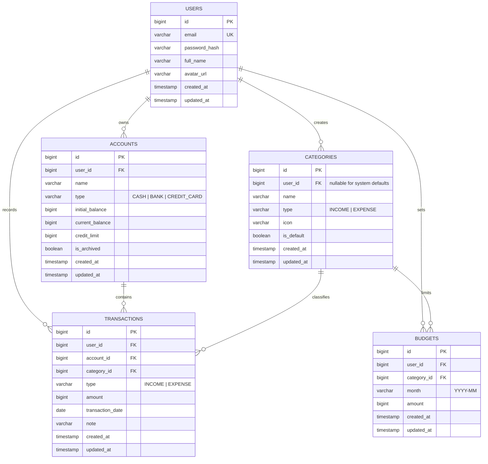
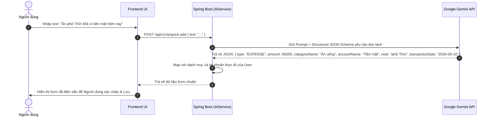
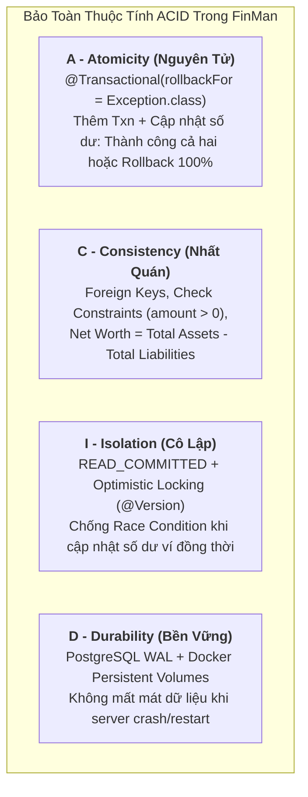

# ARCHITECTURE — FinMan System Architecture
## Hệ Thống Quản Lý Tài Chính Cá Nhân FinMan

---

# 1. Tổng Quan Kiến Trúc (Architecture Overview)

FinMan được thiết kế theo mô hình **Client-Server đa tầng (Multi-tier Architecture)** hiện đại, phân tách hoàn toàn giữa giao diện người dùng (Frontend) và tầng xử lý nghiệp vụ (Backend), kết hợp với dịch vụ trí tuệ nhân tạo (AI Service).

```mermaid
graph TD
    Client["Client Layer\n(Web UI / Mobile PWA / Stitch Interface)"]
    
    subgraph Backend ["Backend Layer (Spring Boot 3.x)"]
        Security["Spring Security 6 & JWT Filter"]
        Controller["REST API Controllers\n(/api/v1/*)"]
        Service["Service Layer\n(Transaction, Balance, Budget Engine)"]
        Repository["Spring Data JPA Repositories"]
    end
    
    subgraph AI ["AI Service"]
        GeminiClient["Google Gemini API Client\n(Gemini 2.0 / 1.5 Flash)"]
    end
    
    subgraph Data ["Persistence Layer"]
        Database[("PostgreSQL / MySQL\nRelational Database")]
    end

    Client -->|HTTPS / REST API (JSON)| Security
    Security --> Controller
    Controller --> Service
    Service --> Repository
    Service -->|Prompt / Structured JSON| GeminiClient
    Repository -->|Hibernate / SQL| Database
```

### Các nguyên tắc kiến trúc cốt lõi:
1. **Stateless Backend**: Backend không lưu session người dùng trong memory, sử dụng JWT (JSON Web Token) để xác thực.
2. **ACID Financial Integrity**: Mọi thao tác ghi nhận dòng tiền (Thêm/Sửa/Xóa giao dịch) đều được bọc trong `@Transactional` của Spring để đảm bảo tính toàn vẹn số dư tài khoản.
3. **Multi-tenant Data Isolation**: Mọi truy vấn đọc/ghi đều bắt buộc kèm theo `userId` của người dùng đã xác thực, triệt tiêu nguy cơ rò rỉ dữ liệu chéo (IDOR).
4. **Zero-Float Precision**: Tất cả dữ liệu tiền tệ được xử lý bằng kiểu số nguyên `Long` (đơn vị Đồng - VND) để loại bỏ hoàn toàn lỗi sai số làm tròn số thực.
5. **Lean & High Performance**: Lược bỏ các bảng phụ trợ phức tạp, chỉ giữ 5 bảng thực thể cốt lõi.

---

# 2. Tech Stack Chi Tiết

| Tầng (Layer) | Công nghệ lựa chọn | Mục đích & Lý do lựa chọn |
| **Frontend** | **React 19 + Vite + TypeScript + Tailwind CSS** | Xây dựng Web Application chuẩn Desktop-First (1600px analytical canvas, 288px dual-rail sidebar) theo chuẩn thiết kế Stitch Fintech Prestige, tiêu thụ REST API từ Spring Boot. |
| **Backend Framework** | **Java 17/21 + Spring Boot 3.x** | Nền tảng enterprise vững chắc, độ ổn định cao, quản lý transaction tài chính chuẩn mực. |
| **Security** | Spring Security 6 + JJWT | Xác thực stateless JWT Bearer Token, mã hóa mật khẩu BCrypt. |
| **ORM / Data Access** | Spring Data JPA (Hibernate) | Quản lý quan hệ thực thể, tối ưu truy vấn với JPQL & Specification, hỗ trợ migration. |
| **Database** | PostgreSQL (khuyến nghị) / MySQL | Hệ quản trị cơ sở dữ liệu quan hệ mạnh mẽ, ACID tuyệt đối, hỗ trợ kiểu dữ liệu `BIGINT`. |
| **AI Integration** | Google Gemini API (REST Client) | Xử lý ngôn ngữ tự nhiên bóc tách câu giao dịch tiếng Việt và tạo báo cáo nhận xét tài chính. |
| **Excel Export** | Apache POI | Thư viện Java sinh file `.xlsx` chuẩn native, streaming xuất báo cáo trực tiếp về client. |
| **Build & Tooling** | Maven, Docker, Lombok, Jakarta Validation | Quản lý phụ thuộc, container hóa môi trường và tự động hóa validation DTO. |

---

# 3. Database Architecture & ERD (Thiết Kế Cơ Sở Dữ Liệu)

Hệ thống tập trung vào 5 bảng cốt lõi phục vụ trọn vẹn nghiệp vụ quản lý tài chính cá nhân:



### 3.1 Chi tiết các bảng

#### Bảng `users`
Lưu trữ tài khoản người dùng đăng nhập hệ thống.
- `id` (BIGINT, PK, Auto Increment)
- `email` (VARCHAR(100), UNIQUE, NOT NULL): Email đăng nhập.
- `password_hash` (VARCHAR(255), NOT NULL): Mật khẩu băm BCrypt.
- `full_name` (VARCHAR(100), NOT NULL): Họ và tên hiển thị.
- `avatar_url` (VARCHAR(500), NULL): Đường dẫn ảnh đại diện.
- `created_at`, `updated_at` (TIMESTAMP WITH TIME ZONE)

#### Bảng `accounts`
Quản lý ví tiền mặt, tài khoản ngân hàng và thẻ tín dụng.
- `id` (BIGINT, PK, Auto Increment)
- `user_id` (BIGINT, FK -> users.id, NOT NULL): Định danh chủ sở hữu.
- `name` (VARCHAR(50), NOT NULL): Tên tài khoản (Ví dụ: "Tiền mặt", "Vietcombank", "Thẻ Techcombank Visa").
- `type` (VARCHAR(20), NOT NULL): Thuộc `CASH`, `BANK`, `CREDIT_CARD`.
- `initial_balance` (BIGINT, NOT NULL, DEFAULT 0): Số dư lúc khởi tạo ví (đơn vị VNĐ).
- `current_balance` (BIGINT, NOT NULL, DEFAULT 0): Số dư khả dụng hiện tại (hoặc dư nợ hiện tại đối với thẻ tín dụng).
- `credit_limit` (BIGINT, NULL, DEFAULT 0): Hạn mức tín dụng (áp dụng cho `CREDIT_CARD`).
- `is_archived` (BOOLEAN, NOT NULL, DEFAULT FALSE): Trạng thái đóng/ẩn tài khoản thay vì xóa cứng.
- `created_at`, `updated_at` (TIMESTAMP WITH TIME ZONE)

#### Bảng `categories`
Phân loại các khoản chi tiêu và thu nhập.
- `id` (BIGINT, PK, Auto Increment)
- `user_id` (BIGINT, FK -> users.id, NULL): Nếu `NULL` là danh mục hệ thống mặc định, có giá trị là danh mục do người dùng tự tạo.
- `name` (VARCHAR(50), NOT NULL): Tên danh mục ("Ăn uống", "Lương", "Áo quần"...).
- `type` (VARCHAR(20), NOT NULL): Thuộc `INCOME` hoặc `EXPENSE`.
- `icon` (VARCHAR(50), NULL): Biểu tượng hoặc emoji (ví dụ: `🍜`, `💰`, `👕`).
- `is_default` (BOOLEAN, NOT NULL, DEFAULT FALSE): Đánh dấu danh mục ban đầu do hệ thống tạo.
- `created_at`, `updated_at` (TIMESTAMP WITH TIME ZONE)

#### Bảng `transactions`
Lưu trữ toàn bộ lịch sử biến động tiền tệ.
- `id` (BIGINT, PK, Auto Increment)
- `user_id` (BIGINT, FK -> users.id, NOT NULL)
- `account_id` (BIGINT, FK -> accounts.id, NOT NULL): Tài khoản phát sinh giao dịch.
- `category_id` (BIGINT, FK -> categories.id, NOT NULL): Danh mục thu/chi.
- `type` (VARCHAR(20), NOT NULL): Thuộc `INCOME` hoặc `EXPENSE` (Không có chuyển khoản).
- `amount` (BIGINT, NOT NULL): Số tiền giao dịch (luôn dương > 0).
- `transaction_date` (DATE, NOT NULL): Ngày phát sinh giao dịch (YYYY-MM-DD).
- `note` (VARCHAR(255), NULL): Ghi chú diễn giải.
- `created_at`, `updated_at` (TIMESTAMP WITH TIME ZONE)

#### Bảng `budgets`
Thiết lập hạn mức chi tiêu cho từng danh mục theo tháng.
- `id` (BIGINT, PK, Auto Increment)
- `user_id` (BIGINT, FK -> users.id, NOT NULL)
- `category_id` (BIGINT, FK -> categories.id, NOT NULL): Danh mục chi tiêu được áp hạn mức.
- `month` (VARCHAR(7), NOT NULL): Chu kỳ tháng áp dụng, định dạng `YYYY-MM` (Ví dụ: `2026-09`).
- `amount` (BIGINT, NOT NULL): Hạn mức ngân sách tối đa trong tháng (VNĐ).
- `created_at`, `updated_at` (TIMESTAMP WITH TIME ZONE)
- **Ràng buộc duy nhất (Unique Constraint)**: `UNIQUE (user_id, category_id, month)` — mỗi danh mục chỉ có 1 ngân sách duy nhất trong 1 tháng.

### 3.2 Database Indexes tối ưu hiệu năng
- `CREATE INDEX idx_transactions_user_date ON transactions(user_id, transaction_date DESC);` (Tối ưu tải danh sách giao dịch phân trang theo thời gian).
- `CREATE INDEX idx_transactions_user_account ON transactions(user_id, account_id);` (Tối ưu tính toán và kiểm tra số dư).
- `CREATE INDEX idx_budgets_user_month ON budgets(user_id, month);` (Tối ưu màn hình ngân sách).
- `CREATE INDEX idx_accounts_user ON accounts(user_id) WHERE is_archived = FALSE;` (Tối ưu tải danh sách ví hoạt động).

---

# 4. Cấu Trúc Dự Án Toàn Diện (Monorepo Layout)

Dự án FinMan được tổ chức theo mô hình Monorepo sạch, phân tách rõ ràng giữa Backend, Frontend, Tài liệu thiết kế Stitch và Kế hoạch kỹ thuật:

```text
d:\FinMan/
├── backend/                             # [BACKEND] Mã nguồn Java Spring Boot 3.x
│   ├── src/main/java/com/finman/
│   │   ├── config/                      # Cấu hình Spring Security, CORS, Gemini REST Client
│   │   ├── controller/                  # REST API Controllers (/api/v1/*)
│   │   ├── dto/                         # Request & Response DTOs
│   │   ├── entity/                      # JPA Entities (User, Account, Category, Transaction, Budget)
│   │   ├── exception/                   # Global Exception Handler
│   │   ├── repository/                  # Spring Data JPA Repositories
│   │   ├── security/                    # JWT Provider & Authentication Filter
│   │   └── service/                     # Transaction Engine, Budget Engine, AI, Export
│   ├── src/main/resources/              # application.yml, seed data
│   └── pom.xml                          # Maven build dependencies
│
├── frontend/                            # [FRONTEND] Web Application (React 19 + Vite + Tailwind CSS)
│   ├── index.html                       # HTML Shell, Google Fonts (Plus Jakarta Sans & Inter), Material Symbols
│   ├── vite.config.ts                   # Cấu hình Vite build & proxy
│   ├── tailwind.config.js               # Fintech Prestige Design Tokens (Colors, Typography, Spacing)
│   ├── src/
│   │   ├── components/
│   │   │   ├── layout/                  # Sidebar (288px fixed), TopHeader (sticky search & month switcher)
│   │   │   └── modals/                  # AddTransactionModal (Glassmorphism, Quick Amount chips)
│   │   ├── context/                     # AuthContext (JWT auth state & demo fallback)
│   │   ├── pages/                       # Các trang Web chính từ Stitch
│   │   │   ├── auth/                    # LoginPage, RegisterPage (Desktop split presentation)
│   │   │   ├── dashboard/               # DashboardPage (KPI strip, AI prompt, ledger, net worth rail)
│   │   │   ├── budget/                  # BudgetPage (Hạn mức tổng thể, segmented progress bars)
│   │   │   ├── accounts/                # AccountsPage (Dark Gunmetal VIP Net worth card, danh sách ví/thẻ)
│   │   │   ├── statistics/              # StatisticsPage (Biểu đồ Thu/Chi, thặng dư dòng tiền)
│   │   │   ├── ai/                      # AIAssistantPage (Gemini 2.0 Flash chat & bóc tách tiếng Việt)
│   │   │   └── settings/                # SettingsPage (Profile, danh mục, xuất Excel)
│   │   ├── services/                    # Axios API Client (api.ts) & mockData.ts
│   │   ├── types/                       # TypeScript models (Transaction, Account, Budget, User)
│   │   ├── App.tsx                      # Root App Component điều phối Routing & State
│   │   ├── main.tsx                     # React DOM Root
│   │   └── index.css                    # Tabular lining figures, thin scrollbar, base styles
│   └── package.json                     # Vite & React dependencies
│
├── design/                              # [STITCH WEB DESIGN SOURCE] 7 Màn hình Web chuẩn Desktop + DESIGN.md
│   ├── finman_web_ng_nh_p_h_th_ng/      # Màn hình Đăng nhập Web (code.html & screen.png)
│   ├── finman_web_ng_k_t_i_kho_n/       # Màn hình Đăng ký Web (code.html & screen.png)
│   ├── finman_web_giao_d_ch_dashboard/  # Màn hình Dashboard & Sổ cái Giao dịch Web
│   ├── finman_web_popup_th_m_giao_d_ch_m_i/ # Modal Thêm giao dịch Glassmorphism Web
│   ├── finman_web_qu_n_l_ng_n_s_ch/     # Màn hình Quản lý Ngân sách chi tiêu Web
│   ├── finman_web_t_i_kho_n_t_i_s_n_r_ng/ # Màn hình Tài khoản & Tài sản ròng Web
│   ├── finman_web_th_ng_k_b_o_c_o/      # Màn hình Thống kê & Báo cáo dòng tiền Web
│   └── fintech_prestige/                # DESIGN.md - Bộ quy chuẩn thiết kế Fintech Prestige
│
├── plans/                               # [PLANS] Bộ 6 tài liệu kỹ thuật
│   ├── PRD.md
│   ├── ARCHITECTURE.md
│   ├── CODE_PLAN.md
│   ├── GEMINI.md
│   ├── TEST_PLAN.md
│   └── PROCESS.md
│
└── docker-compose.yml                   # Khởi chạy PostgreSQL môi trường dev
```

---

# 5. Backend Layer Architecture (Spring Boot 3.x)

Backend được tổ chức theo kiến trúc chuẩn mực Spring Boot với phân tách rõ ràng các tầng:

### 4.1 Cơ chế cập nhật số dư tài khoản (Transaction Engine)
Mỗi thao tác ghi nhận giao dịch tại `TransactionService` đều phải đảm bảo:
```java
@Transactional
public TransactionResponse createTransaction(Long userId, CreateTransactionRequest request) {
    // 1. Validate Account & Category thuộc sở hữu của User
    // 2. Lưu Transaction Entity
    // 3. Cập nhật số dư Account tương ứng:
    //    - Nếu INCOME: account.setCurrentBalance(account.getCurrentBalance() + request.getAmount())
    //    - Nếu EXPENSE: account.setCurrentBalance(account.getCurrentBalance() - request.getAmount())
    // 4. Lưu Account Entity (Hibernate tự động commit hoặc rollback nếu lỗi)
}
```

---

# 5. AI Service Component (Gemini Integration)

Hệ thống sử dụng **Google Gemini REST API** (`gemini-2.0-flash` hoặc `gemini-1.5-flash`) nhờ tốc độ phản hồi cực nhanh (< 1 giây) và chi phí tối ưu.



### Prompt Template cho Natural Language Quick Add:
```text
System: Bạn là trợ lý trích xuất dữ liệu giao dịch tài chính cho ứng dụng FinMan tại Việt Nam.
Nhiệm vụ: Phân tích câu nói/văn bản của người dùng và trích xuất thành JSON thuần túy theo schema:
{
  "type": "INCOME" hoặc "EXPENSE",
  "amount": số nguyên dương (đơn vị VNĐ, ví dụ: 50k -> 50000, 1.5 triệu -> 1500000),
  "categoryName": tên danh mục gợi ý phù hợp nhất (Ăn uống, Giải trí, Lương, Áo quần...),
  "accountName": tên tài khoản ví (Tiền mặt, Ngân hàng...),
  "note": mô tả ngắn gọn nội dung chi tiêu,
  "transactionDate": ngày theo định dạng YYYY-MM-DD (nếu nói 'hôm nay' thì lấy {currentDate}, 'hôm qua' thì trừ 1 ngày)
}
Chỉ trả về duy nhất chuỗi JSON hợp lệ, không kèm markdown hoặc giải thích thêm.
```

---

# 6. REST API Specification

### 6.1 Chuẩn phản hồi chung (ApiResponse Format)
```json
{
  "success": true,
  "message": "Thao tác thành công",
  "data": { ... },
  "timestamp": 1758000000000
}
```
Khi có lỗi nghiệp vụ hoặc validation:
```json
{
  "success": false,
  "message": "Dữ liệu không hợp lệ",
  "error": {
    "code": "VALIDATION_FAILED",
    "details": {
      "amount": "Số tiền phải lớn hơn 0",
      "email": "Email không đúng định dạng"
    }
  },
  "timestamp": 1758000000000
}
```

### 6.2 Danh sách Endpoints cốt lõi

| Module | Method | Endpoint | Mô tả |
|---|---|---|---|
| **Auth** | `POST` | `/api/v1/auth/register` | Đăng ký tài khoản mới + tự sinh ví mặc định và danh mục mẫu |
| **Auth** | `POST` | `/api/v1/auth/login` | Đăng nhập bằng email/password, trả về JWT Access Token |
| **Auth** | `GET` | `/api/v1/auth/me` | Lấy thông tin cá nhân của người dùng hiện tại |
| **Accounts** | `GET` | `/api/v1/accounts` | Danh sách các ví/tài khoản (Tiền mặt, Ngân hàng, Thẻ tín dụng) kèm số dư |
| **Accounts** | `POST` | `/api/v1/accounts` | Tạo tài khoản/ví tiền mới |
| **Accounts** | `PUT` | `/api/v1/accounts/{id}` | Cập nhật thông tin tài khoản |
| **Accounts** | `DELETE` | `/api/v1/accounts/{id}` | Lưu trữ (archive) hoặc xóa tài khoản nếu chưa có giao dịch |
| **Categories** | `GET` | `/api/v1/categories` | Lấy danh sách danh mục phân loại (hệ thống + người dùng tự tạo) |
| **Categories** | `POST` | `/api/v1/categories` | Tạo danh mục mới |
| **Categories** | `PUT` | `/api/v1/categories/{id}` | Đổi tên/icon danh mục |
| **Categories** | `DELETE` | `/api/v1/categories/{id}` | Xóa danh mục (nếu chưa có giao dịch liên kết) |
| **Transactions**| `GET` | `/api/v1/transactions` | Lấy danh sách giao dịch hỗ trợ filter: `month=YYYY-MM`, `from`, `to`, `accountId`, `categoryId`, `keyword` |
| **Transactions**| `POST` | `/api/v1/transactions` | Tạo giao dịch Thu hoặc Chi (+/- số dư tài khoản tương ứng) |
| **Transactions**| `GET` | `/api/v1/transactions/{id}` | Chi tiết một giao dịch |
| **Transactions**| `PUT` | `/api/v1/transactions/{id}` | Chỉnh sửa giao dịch (tự động hoàn tác số dư cũ và áp số dư mới) |
| **Transactions**| `DELETE`| `/api/v1/transactions/{id}` | Xóa giao dịch (hoàn lại số tiền vào tài khoản tương ứng) |
| **Budgets** | `GET` | `/api/v1/budgets` | Lấy danh sách ngân sách tháng `?month=YYYY-MM` kèm số tiền đã chi & còn lại |
| **Budgets** | `POST` | `/api/v1/budgets` | Thiết lập hoặc cập nhật ngân sách cho danh mục |
| **Budgets** | `DELETE` | `/api/v1/budgets/{id}` | Xóa thiết lập ngân sách |
| **AI** | `POST` | `/api/v1/ai/quick-add` | Gửi câu văn bản tự nhiên để AI bóc tách thông tin giao dịch |
| **AI** | `POST` | `/api/v1/ai/insights` | Yêu cầu AI tổng hợp phân tích tài chính và đưa ra nhận xét tháng `YYYY-MM` |
| **Export** | `GET` | `/api/v1/export/excel` | Tải về file `.xlsx` toàn bộ lịch sử giao dịch theo khoảng thời gian |

---

# 7. Security & Non-Functional Requirements

1. **Authentication & Authorization**:
   - Sử dụng JWT Stateless với thời gian hết hạn hợp lý (ví dụ: 7 ngày hoặc 24h kết hợp refresh).
   - Filter `JwtAuthenticationFilter` giải mã token, lấy `userId` gán vào `SecurityContextHolder`.
2. **Data Isolation (Tenant Boundary)**:
   - Tất cả các truy vấn JPA bắt buộc phải có điều kiện `WHERE user_id = :currentUserId`.
   - Ngăn chặn triệt để lỗ hổng IDOR khi một người dùng cố tình truyền ID giao dịch của người khác.
3. **Mã hóa mật khẩu**:
   - Sử dụng chuẩn `BCryptPasswordEncoder` với độ dài salt 10-12 vòng.
4. **CORS Configuration**:
   - Cấu hình cho phép Frontend truy cập an toàn với các header `Authorization`, `Content-Type`.
5. **Độ chính xác dữ liệu tài chính**:
   - Sử dụng kiểu dữ liệu `BIGINT` trong cơ sở dữ liệu và `Long` trong mã nguồn Java. Không phát sinh số thập phân cho đồng VND.


---

# 8. Bộ Nguyên Tắc Thiết Kế Kỹ Thuật & Kiến Trúc Cốt Lõi (Core Engineering & Architecture Principles)

Hệ thống FinMan áp dụng nghiêm ngặt các nguyên tắc thiết kế phần mềm doanh nghiệp nhằm đảm bảo mã nguồn sạch (Clean Code), có khả năng mở rộng cao, và đảm bảo tính chính xác tuyệt đối trong giao dịch tài chính.

## 8.1 Bộ Nguyên Tắc SOLID (SOLID Principles in Action)

### 1. S — Single Responsibility Principle (Đơn Trách Nhiệm)
- **Tầng Controller (`*Controller.java`)**: Chỉ chịu trách nhiệm tiếp nhận HTTP request, điều hướng, parse dữ liệu, validate input thông qua `@Valid`, và trả về `ResponseEntity<ApiResponse<T>>`. Tuyệt đối không chứa logic nghiệp vụ tính toán dòng tiền hay truy vấn database trực tiếp.
- **Tầng Service (`*Service.java` / `*ServiceImpl.java`)**: Đóng gói toàn bộ logic nghiệp vụ (Business Rules), tính toán số dư, điều phối transaction và tích hợp AI. Mỗi Service tập trung vào một phân hệ độc lập: `AuthService`, `AccountService`, `TransactionService`, `BudgetService`, `AiService`, `ExportService`.
- **Tầng Repository (`*Repository.java`)**: Chỉ phụ trách việc giao tiếp dữ liệu với PostgreSQL bằng Spring Data JPA/Hibernate và JPQL queries.
- **Tầng DTO (Data Transfer Objects)**: Phân tách rõ ràng giữa Request DTO (`CreateTransactionRequest`, `UpdateBudgetRequest`) và Response DTO (`TransactionResponse`, `AccountSummaryResponse`), không để lộ trực tiếp Entity JPA ra ngoài API.
- **Tầng Frontend React**: Tách biệt giữa **Container / Page Components** (quản lý state, gọi API) và **Presentational / UI Components** (nhận props và hiển thị giao diện thuần túy).

### 2. O — Open/Closed Principle (Mở Rộng Nhưng Đóng Kín)
- Hệ thống thiết kế theo cơ chế Interface và Strategy Pattern để dễ dàng mở rộng mà không làm thay đổi mã nguồn đã chạy ổn định:
  - **AI Provider Strategy (`AiProviderService`)**: Định nghĩa interface chung. Hiện tại triển khai bằng `GeminiAiServiceImpl`, nhưng sẵn sàng cắm thêm `OpenAiServiceImpl` hoặc `LocalLlmServiceImpl` mà không sửa đổi `TransactionService`.
  - **Export Strategy (`ExportService`)**: Interface chung cho phép mở rộng xuất `ExcelExportServiceImpl`, `CsvExportServiceImpl`, hoặc `PdfExportServiceImpl`.
  - **Account Types & Transaction Types**: Đóng gói bằng Java Enums (`AccountType`, `TransactionType`) kết hợp với các phương thức đa hình (polymorphic handling) khi xử lý cộng/trừ số dư.

### 3. L — Liskov Substitution Principle (Thay Thế Liskov)
- Các lớp con hoặc lớp triển khai (Implementations) phải hoàn toàn có thể thay thế cho Interface mà không làm sai lệch tính đúng đắn của chương trình:
  - Mọi `UserDetails` tùy biến (`CustomUserDetails`) phải tuân thủ chuẩn xác hợp đồng của Spring Security `UserDetails`.
  - Các Exception tùy biến (`ResourceNotFoundException`, `InsufficientBalanceException`, `UnauthorizedException`) đều kế thừa từ `FinManBaseException` (kế thừa `RuntimeException`) và được xử lý nhất quán bởi `GlobalExceptionHandler` (`@RestControllerAdvice`).

### 4. I — Interface Segregation Principle (Phân Tách Giao Diện)
- Thay vì tạo một "God Interface" khổng lồ, FinMan chia nhỏ các interface theo đúng mục đích sử dụng của từng client:
  - Tách riêng `TransactionQueryService` (các thao tác đọc dữ liệu, lọc báo cáo) và `TransactionCommandService` (các thao tác ghi, cập nhật, xóa có thay đổi state) nếu cần scale theo CQRS.
  - Tách riêng `ExcelReportGenerator` độc lập khỏi `TransactionService` để Service chính không bị phụ thuộc vào thư viện Apache POI nặng nề.

### 5. D — Dependency Inversion Principle (Đảo Ngược Phụ Thuộc)
- Các module cấp cao (Services) không phụ thuộc trực tiếp vào các module cấp thấp cụ thể, mà phụ thuộc vào các Abstraction (Interfaces).
- **Tuyệt đối cấm sử dụng Field Injection (`@Autowired` trên field)**: Bắt buộc sử dụng **Constructor Injection** kết hợp với Lombok `@RequiredArgsConstructor` để đảm bảo:
  - Các dependency là `final` (bất biến sau khi khởi tạo).
  - Dễ dàng Unit Test bằng Mockito mà không cần bật Spring Context nặng nề.
  - Phát hiện lỗi Circular Dependency ngay từ thời điểm biên dịch.

---

## 8.2 Đảm Bảo Tuyệt Đối Các Thuộc Tính ACID Trong Giao Dịch Tài Chính (ACID Financial Guarantees)

Tài chính cá nhân đòi hỏi tính chính xác 100% đến từng đồng VNĐ. FinMan thiết lập cơ chế bảo toàn ACID chặt chẽ:



### 1. Atomicity (Tính Nguyên Tử):
- Mọi nghiệp vụ thay đổi số dư (createTransaction, updateTransaction, deleteTransaction) đều phải được đánh dấu @Transactional(rollbackFor = Exception.class). FinMan là ứng dụng quản lý thu chi cá nhân, chỉ hỗ trợ 2 loại giao dịch: INCOME (+ balance ví) và EXPENSE (- balance ví), tuyệt đối không có chuyển khoản/banking transfer.
- **Ví dụ kịch bản**: Khi tạo giao dịch chi tiêu `500.000đ`:
  1. Thêm bản ghi vào bảng `transactions`.
  2. Trừ `500.000đ` trong trường `current_balance` của bảng `accounts`.
  3. Cập nhật số tiền đã chi trong `budgets`.
  - Nếu bất kỳ bước nào (ví dụ lỗi DB constraint hoặc mất kết nối) xảy ra sự cố, **toàn bộ 3 thao tác đều bị Rollback về trạng thái ban đầu**, tuyệt đối không bao giờ xảy ra tình trạng "trừ tiền ví nhưng không có giao dịch" hoặc ngược lại.

### 2. Consistency (Tính Nhất Quán):
- Dữ liệu luôn chuyển từ một trạng thái hợp lệ này sang một trạng thái hợp lệ khác:
  - **Invariants**: `current_balance` của ví phải luôn bằng `initial_balance + SUM(incomes) - SUM(expenses)`.
  - Ràng buộc khóa ngoại: Không cho phép tạo giao dịch tham chiếu đến `accountId` hoặc `categoryId` không tồn tại hoặc thuộc sở hữu của User khác.
  - Ràng buộc miền giá trị: Số tiền giao dịch `amount` bắt buộc phải $> 0$.

### 3. Isolation (Tính Cô Lập & Kiểm Soát Đồng Thời - Concurrency Control):
- **Cơ chế chống Race Condition (Lost Update Problem)**:
  - Khi hai thiết bị hoặc hai tiến trình cùng lúc cập nhật số dư của cùng một tài khoản (ví dụ: vừa quẹt thẻ chi tiêu vừa nhận lương chuyển khoản), nếu không cô lập sẽ dẫn đến lỗi ghi đè mất mát số dư.
  - **Giải pháp**: Áp dụng **Optimistic Locking (Khóa Lạc Quan)** bằng trường `@Version private Long version;` trên thực thể `Account`. Khi xảy ra xung đột đồng thời, Hibernate sẽ ném ra `OptimisticLockException`, tầng Service sẽ tự động retry hoặc thông báo an toàn cho client thay vì làm sai số dư.

### 4. Durability (Tính Bền Vững):
- Mọi giao dịch đã commit thành công sẽ tồn tại vĩnh viễn trên đĩa cứng thông qua cơ chế Write-Ahead Logging (WAL) của PostgreSQL và Docker Named Volumes (`taskflow_pgdata`). Khi khởi động lại container, trạng thái dòng tiền vẫn được bảo toàn nguyên vẹn.

---

## 8.3 Chuẩn Quy Ước Đặt Tên (Universal Naming Conventions)

Toàn bộ dự án tuân thủ nghiêm ngặt quy ước đặt tên chuẩn hóa theo từng ngôn ngữ và nền tảng:

| Quy ước | Áp dụng cho | Quy tắc & Ví dụ cụ thể |
|---|---|---|
| **`camelCase`** | **Java & TypeScript**: Tên biến, tham số, tên method, trường trong DTO.<br/>**REST API JSON**: Tất cả các keys trong Request Body và Response JSON. | - Biến/Trường: `userId`, `accountName`, `currentBalance`, `transactionDate`, `dueDate`, `isArchived`.<br/>- Method: `calculateNetWorth()`, `getTransactionHistory()`, `updateAccountBalance()`.<br/>- JSON Payload: `{"accountId": 1, "transactionType": "EXPENSE", "currentBalance": 5000000}`. |
| **`snake_case`** | **PostgreSQL Database**: Tên bảng (Table names), tên cột (Column names), tên khóa ngoại, index. | - Bảng: `users`, `accounts`, `categories`, `transactions`, `budgets`.<br/>- Cột: `user_id`, `current_balance`, `initial_balance`, `password_hash`, `created_at`, `updated_at`. |
| **`PascalCase`** | **Java**: Tên Class, Interface, Enum, Record, Exception.<br/>**React**: Tên Component, Custom Hook files, Types/Interfaces TypeScript. | - Java: `TransactionController`, `AccountService`, `AccountType`, `ResourceNotFoundException`.<br/>- React: `DashboardPage`, `AddTransactionModal`, `TransactionCard`, `UserProfile`. |
| **`SCREAMING_SNAKE_CASE`** | **Java & TypeScript**: Hằng số tĩnh (`static final`), giá trị Enum.<br/>**Hệ thống**: Biến môi trường `.env`, hằng số cấu hình. | - Enums: `EXPENSE`, `INCOME`, `CASH`, `BANK`, `CREDIT_CARD`, `ROLE_USER`, `ROLE_ADMIN`.<br/>- Constants: `DEFAULT_PAGE_SIZE`, `MAX_TRANSACTION_AMOUNT`, `JWT_EXPIRATION_TIME`.<br/>- Env: `OPENAI_API_KEY`, `POSTGRES_DB`, `SPRING_DATASOURCE_URL`. |
| **`kebab-case`** | **REST API**: URL path segments.<br/>**Frontend**: Tên file CSS, class Tailwind, artifact files. | - URL: `/api/v1/accounts`, `/api/v1/transactions`, `/api/v1/ai/quick-add`, `/api/v1/export/excel`.<br/>- CSS/File: `transaction-list.css`, `dual-rail-layout.tsx`. |

---

## 8.4 Nguyên Tắc Zero-Float Precision (Cấm Dùng Số Thực Trong Tài Chính)

> [!CAUTION]
> **Tuyệt đối cấm sử dụng kiểu dữ liệu `float` hoặc `double`** trong cả Java Backend lẫn cơ sở dữ liệu để lưu trữ số tiền.
> Số thực dấu chấm động chuẩn IEEE 754 có sai số tích lũy (ví dụ: `0.1 + 0.2 = 0.30000000000000004`), dẫn đến sai lệch số dư ví và tài sản ròng.

* **Quy chuẩn lưu trữ và tính toán**:
  * Đơn vị tiền tệ chính: **Đồng Việt Nam (VNĐ)**.
  * Trong Database: Kiểu cột `BIGINT` (chứa được giá trị tới $9 \times 10^{18}$ VNĐ, vượt xa quy mô tài sản cá nhân).
  * Trong Java Backend: Sử dụng `Long` cho các phép cộng/trừ số dư thông thường; hoặc `BigDecimal` khi cần tính toán tỷ lệ phân bổ ngân sách / phần trăm.
  * Trong Frontend TypeScript: Sử dụng `number` (hỗ trợ số nguyên an toàn `Number.MAX_SAFE_INTEGER` đến 9 triệu tỷ) kết hợp hàm format `Intl.NumberFormat('vi-VN')`.

---

## 8.5 Định Dạng Phản Hồi API Đồng Nhất (Standard API Envelope)

Mọi endpoint đều trả về một khuôn mẫu JSON thống nhất để Frontend dễ dàng bắt lỗi và bóc tách dữ liệu:

* **Phản hồi thành công (HTTP 200/201)**:
```json
{
  "success": true,
  "data": { ... },
  "message": "Thao tác thành công",
  "timestamp": 1758000000000
}
```

* **Phản hồi lỗi (HTTP 400/401/403/404/500)**:
```json
{
  "success": false,
  "errorCode": "INSUFFICIENT_BALANCE",
  "message": "Số dư tài khoản không đủ để thực hiện giao dịch",
  "errors": [
    {
      "field": "amount",
      "rejectedValue": 10000000,
      "message": "Số tiền vượt quá số dư khả dụng"
    }
  ],
  "timestamp": 1758000000000
}
```
